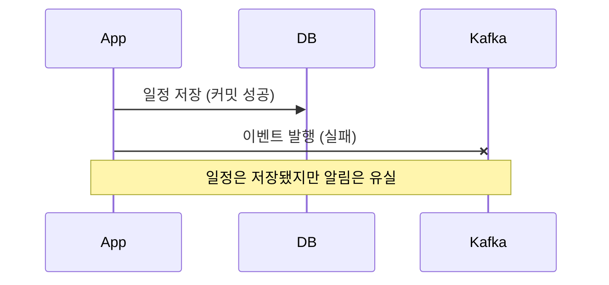
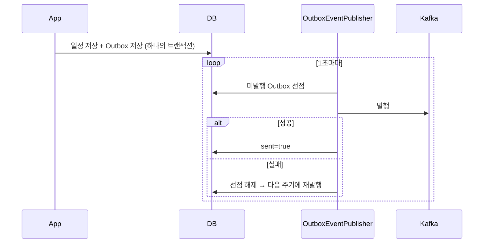

# 설계 과정 의사결정

일정 생성 한 건이 끝나면 알림 발송, 챗봇 이력 저장, 패턴 분석이 이어집니다.
이를 동기로 처리하면 응답 시간이 후속 작업 수만큼 늘고, 후속 처리 하나가 실패해도 일정 저장까지 롤백됩니다.

## 1. @Async / ApplicationEvent 대신 Kafka를 선택한 이유

| 요구사항 | @Async / ApplicationEvent | Kafka |
|---|---|---|
| 이벤트 보존 | 메모리 안에서만 전달, 서버 재시작·장애 시 유실 | 브로커에 저장, 오프셋 기준으로 실패 구간부터 재처리 |
| 서버 간 전달 | 같은 JVM 안에서만 동작 | App 2대 어느 쪽에서 발행해도 컨슈머 그룹이 나눠 처리 |
| 처리 속도 분리 | 발행 서버의 스레드 풀을 함께 사용 | 컨슈머 그룹마다 오프셋이 따로 있어 각자 속도로 처리 |

## 2. Outbox 패턴을 선택한 이유

**문제: DB 저장과 Kafka 발행이 따로 일어나면**

**해결: Outbox로 같은 트랜잭션에 저장**

- **발행기:** UPDATE 한 번으로 최대 200건을 선점(`claim_id`)한 뒤 발행합니다. 성공 건은 일괄 `sent=true`로, 실패 건은 선점을 해제해 다음 주기에 다시 발행합니다.
- **ShedLock (Redis):** App 2대 중 한 대만 발행기를 실행합니다. 락이 겹치는 순간이나 발행 도중 서버가 죽는 경우는 선점 조건(`claim_id`, 30초)이 막고, 그래도 생길 수 있는 중복 전달은 컨슈머 멱등 처리가 막습니다.
- **Producer `acks=all` + `enable.idempotence=true`:** 브로커 장애에도 유실되지 않고, 재전송으로 인한 중복 기록을 막습니다.

## 3. 멱등성 + DLQ

Outbox는 "최소 한 번" 발행을 보장하므로 같은 이벤트가 두 번 올 수 있습니다. 중복은 컨슈머가 막습니다.

- **멱등성:** `processed_event`에 `(consumer, event_id)`를 기록합니다. 하나의 이벤트를 여러 컨슈머 그룹이 각자 처리하므로 키에 컨슈머를 포함했습니다.
- **`AckMode.MANUAL_IMMEDIATE`:** 처리와 기록이 끝난 뒤에만 오프셋을 커밋합니다.
- **`ErrorHandlingDeserializer`:** 역직렬화할 수 없는 메시지(Poison Pill)가 컨슈머를 멈추지 않게 합니다.
- **재시도 → DLQ → 재처리:** 컨슈머가 실패하면 `DefaultErrorHandler`가 2초 간격으로 3번 재시도하고, 그래도 실패하면 `DeadLetterPublishingRecoverer`로 DLQ에 보냅니다. DLQ 컨슈머가 실패 메시지를 `failed_message`에 기록하고, 30초 주기 스케줄러가 재시도 시각이 된 기록을 다시 발행합니다. 재발행한 메시지가 다시 실패해 DLQ로 돌아오면 새 기록을 만들지 않고 같은 기록을 다시 열어 횟수를 올리며, 재발행 간격은 기록의 다음 재시도 시각으로 늘립니다(5초 → 30초 → 1분 → 5분, 최대 4번). 4번째 재발행도 실패하면 포기(dead)로 표시하고 Slack으로 알립니다. 재시도 3회 → DLQ → 롤백, DLQ → 재발행 → 재실패 시 같은 기록 재개 → 최종 포기까지 실제 Kafka 통합 테스트로 확인했습니다. 챗봇 이벤트는 DLQ까지만 보냅니다.
- **저장 단위와 부수 작업:** 업무 데이터와 `processed_event`는 `TransactionTemplate` 하나로 함께 커밋하고, 저장 중 예외는 전파해 위 재시도 경로를 탑니다. 실시간 전달·메일·오프셋 커밋은 트랜잭션이 끝나 커넥션을 반납한 뒤에 합니다. 커밋 이후 콜백(`afterCommit`)은 커넥션이 묶인 채라, 메일 재시도가 커넥션을 붙잡거나 실패 기록 저장이 버려질 수 있어 쓰지 않았습니다.
- **순서:** 메시지 키는 대상 ID(일정·회원·채팅 회원)이고, 재처리 재발행도 같은 키로 보내 같은 파티션에서 순서대로 처리됩니다. 단, 발행 실패나 DLQ를 거친 메시지는 뒤 메시지보다 늦게 처리될 수 있습니다. 지금 컨슈머는 알림·이력처럼 기록을 쌓는 처리라 순서가 바뀌어도 데이터가 틀어지지 않으며, 상태를 덮어쓰는 컨슈머가 생기면 이벤트 버전으로 오래된 이벤트를 걸러야 합니다. 유실과 중복은 위 경로와 멱등 처리로 막습니다.

## 4. 외부 API 격리 — 챗봇 서킷브레이커

OpenAI 장애나 지연이 일정 서비스로 번지지 않도록 Resilience4j 서킷브레이커로 격리했습니다.

- **타임아웃:** 첫 응답 대기와 스트리밍 중 무응답 시간을 따로 제한합니다.
- **차단:** 실패율이 기준을 넘으면 회로를 열어, OpenAI를 호출하지 않고 즉시 대체 응답을 돌려줍니다.
- **대체 응답은 이력에 저장하지 않습니다:** 장애 중 안내 문구가 대화 맥락에 섞이지 않게 했습니다.

이벤트 흐름의 단계별 그림과 재시도 표는 [이벤트 흐름 상세](../event/event-flow.md)에 있습니다.
