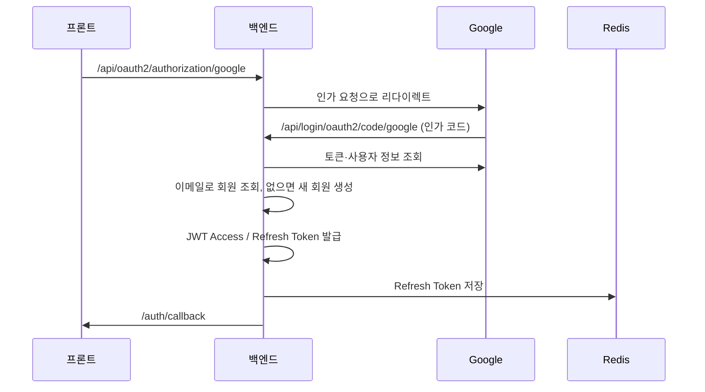

### 인증 아키텍처 개요

프로젝트의 인증은 Stateless 아키텍처를 기반으로 JWT Access / Refresh Token 방식을 사용하여 인증을 구현했습니다.
로그인 방식은 아이디·비밀번호 로그인과 Google 소셜 로그인(OAuth2) 두 가지이며, 어느 쪽으로 로그인해도 같은 JWT를 발급해 이후 요청은 똑같이 처리합니다.

단순 로그인 처리에 그치지 않고, 토큰 탈취, 만료, 로그아웃, 재발급 시나리오까지 운영 환경에서 발생할 수 있는 인증 이슈를 고려한 구조를 목표로 설계했습니다.

#### 인증 구조 요약

- Access Token: 요청 인증용 토큰 (짧은 수명)
- Refresh Token: 토큰 재발급용 (Redis 저장)
- Stateless 기반 인증 처리 (`SessionCreationPolicy.STATELESS`)
- 상세 흐름(발급·로그아웃·재발급): [JWT 인증](jwt-authentication.md)

#### 설계 핵심 포인트

- 서버 세션을 사용하지 않는 Stateless 인증 구조
- Refresh Token을 Redis에 저장하여 서버 측 토큰 제어 가능
- 로그아웃 시 Access Token 블랙리스트 처리
- WebSocket(STOMP)은 CONNECT 때 Authorization 헤더의 JWT를 검증하고, 회원별 토픽(`/topic/notifications/{id}`, `/topic/chat/{id}`)은 본인만 구독할 수 있습니다 (`WebSocketAuthInterceptor`).

### 소셜 로그인 (OAuth2, Google)

운영에서는 nginx가 `/api/`와 `/ws/`만 백엔드로 넘기기 때문에, Spring Security 기본 경로(`/oauth2/**`, `/login/oauth2/**`) 대신 `/api/oauth2/authorization`, `/api/login/oauth2/code/*`를 씁니다. 또 nginx 뒤에서는 `{baseUrl}`이 내부 주소로 잡혀 Google에 등록한 콜백 주소와 달라지므로, `app.oauth2.callback-base-url`로 직접 지정했습니다.

Google에서 사용자 정보를 받으면 `CustomOAuth2OutConnector`가 이메일로 기존 회원을 찾고, 없으면 `social_`로 시작하는 아이디로 새 회원을 만듭니다.

로그인에 성공하면 `OAuth2AuthenticationSuccessHandler`가 일반 로그인과 같은 JWT를 발급하고 Refresh Token을 Redis에 저장합니다. 토큰은 쿼리스트링이 아니라 URL 프래그먼트(`#`)로 넘겨서 서버 액세스 로그와 Referer 헤더에 남지 않게 했습니다. 실패하면 `OAuth2AuthenticationFailureHandler`가 같은 프론트 콜백 주소에 `?error=`를 붙여 돌려보내고, 프론트가 실패 안내를 보여 줍니다.

#### 소셜 로그인 운영 중 고친 문제

| 문제 | 원인 | 해결 |
|---|---|---|
| 프론트가 토큰을 받지 못함 | 백엔드는 프래그먼트로 보내는데 프론트는 쿼리스트링에서 읽음 | 프론트가 `location.hash`에서 읽도록 통일 |
| 소셜 로그인 후 재발급 실패 | 소셜 로그인 경로에서 Refresh Token을 Redis에 저장하지 않음 | 성공 핸들러에서 일반 로그인과 같은 키(회원 아이디)로 저장 |
| 실패 시 404 | 실패 핸들러가 API 서버의 `/auth/failure`로 보냄 | 프론트 콜백 주소로 `error`를 붙여 보냄 |

#### 한계

인가 요청(state 등)은 Spring Security 기본값대로 서버 세션에 저장됩니다. 그래서 Google에서 돌아온 요청이 처음 요청을 받은 서버로 다시 가야 하고, 지금은 이걸 nginx `ip_hash`에 기대고 있습니다. 서명된 쿠키 기반 저장소로 바꿔서 서버 간에 상태를 나눠 가질 필요가 없게 할 예정입니다.

그 밖에 지원하는 제공자는 아직 Google뿐이고(`OAuth2UserInfo`), `authorized-redirect-uri`가 로컬 프론트 주소로 되어 있어 프론트를 배포하면 운영 주소로 바꿔야 합니다.
