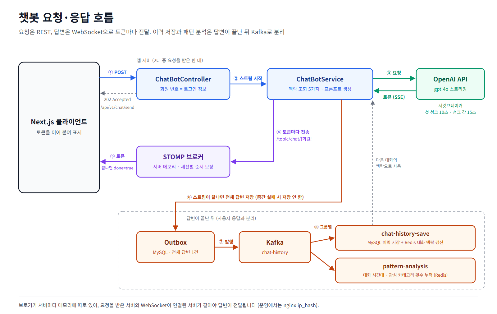
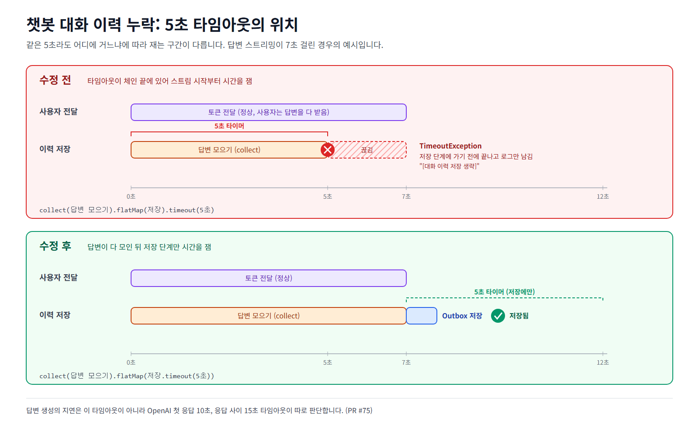

# 챗봇 흐름

사용자의 일정과 대화 패턴을 바탕으로 일정을 추천하는 챗봇입니다. 답변은 토큰 단위로 스트리밍하고, 대화 이력 저장과 패턴 분석은 답변 흐름과 분리해 Kafka로 처리합니다.
이 문서는 요청 → 맥락 조회 → 답변 생성·전달 → 이력 저장·패턴 분석 순서로 실제 코드 동작을 정리합니다. WebSocket을 고른 이유는 [설계 과정 의사결정](../architecture/design-decisions.md) 5번, 이벤트 발행 공통 구조는 [이벤트 흐름](../event/event-flow.md)에 있습니다.

## 한눈에 보기

## 1. 요청

| 항목 | 내용 | 코드 |
|---|---|---|
| 엔드포인트 | `POST /api/v1/chat/send` | `ChatBotController` |
| 회원 번호 | 요청 본문이 아니라 로그인 정보(`SecurityUtil.currentUserId()`)에서 가져옴. 본문 값이 다르면 무시하고 경고 로그 | 〃 |
| 응답 | 스트림 구독을 `ChatBotMessageSender`에 넘기고 바로 `202 Accepted` | 〃 |

답변은 HTTP 응답이 아니라 WebSocket으로 갑니다. 긴 스트리밍을 HTTP 요청 하나에 묶지 않으려고 요청과 응답 채널을 나눴습니다.

## 2. 맥락 조회

`ChatBotService.streamChat`은 프롬프트에 넣을 맥락 5가지를 동시에 조회합니다. 하나가 실패해도 답변은 나가도록, 조회마다 타임아웃을 두고 실패하면 빈 값으로 진행합니다.

| 맥락 | 저장소 | 타임아웃 |
|---|---|---|
| 대화 이력 (최근 10개 메시지, TTL 2시간) | Redis `chat_history:{회원}` | 2초 |
| 최근 일정 5건 | MySQL | 2초 |
| 카테고리별 일정 빈도 | MySQL | 2초 |
| 대화 시간대 패턴 (오전·오후 횟수, TTL 7일) | Redis `pattern:time:{회원}` | 1초 |
| 관심 카테고리 패턴 (TTL 7일) | Redis `pattern:interest:{회원}` | 1초 |

다섯 가지가 모이면 일정과 빈도에 나온 카테고리 이름을 한 번 더 조회합니다(2초, 실패하면 이름 없이 진행).

프롬프트는 시스템 메시지(일정 요약, 카테고리 빈도, 패턴 요약) → 이전 대화 이력 → 현재 질문 순서로 만듭니다.

## 3. 답변 생성과 전달

`OpenAiWebClient.streamChatCompletion`이 OpenAI 스트리밍 API를 WebClient로 호출하고, SSE 청크에서 토큰만 꺼내 `Flux<String>`으로 내보냅니다.

| 장치 | 설정 | 의미 |
|---|---|---|
| 첫 청크 타임아웃 | 10초 | 첫 토큰이 늦으면 실패 |
| 청크 사이 타임아웃 | 15초 | 스트리밍 도중 끊기면 실패 |
| 서킷브레이커 `openAiChat` | 최근 10번 중 50% 실패(최소 5번)면 열림, 30초 뒤 반열림 | 열리면 OpenAI를 호출하지 않음 |

스트림은 전체 시간이 호출 시간으로 잡히므로, 서킷브레이커의 느린 호출 기준은 60초로 넉넉히 두고 지연은 청크 타임아웃으로 판단합니다. 타임아웃을 서킷브레이커보다 앞에 둬서 타임아웃도 실패로 집계됩니다.

실패하면(HTTP 오류, 청크 타임아웃, 서킷 열림) `ChatBotService`가 "죄송합니다. 현재 AI 연결이 원활하지 않습니다…" 안내 문구를 토큰으로 보냅니다. 이 문구는 대화 이력에 저장하지 않아, 장애 중에 나간 안내가 이후 대화 맥락에 섞이지 않습니다. 대체 응답을 `OpenAiWebClient`가 아니라 `ChatBotService`에서 만드는 것도 같은 이유입니다. 여기서 섞으면 정상 답변처럼 흘러가 이력에 저장됩니다.

`ChatBotMessageSender`는 토큰마다 `/topic/chat/{회원}`으로 `{token, done:false}`를 보내고, 끝나면 `{"", done:true}`, 오류면 `{"오류 발생", done:true}`를 보냅니다.

| WebSocket 설정 | 내용 | 코드 |
|---|---|---|
| 엔드포인트 | `/ws` 하나(SockJS). 알림과 챗봇은 토픽만 다름 | `WebSocketConfig` |
| 브로커 | `enableSimpleBroker("/topic")`, 서버 메모리 | 〃 |
| 순서 | `setPreservePublishOrder(true)`. 없으면 스레드 풀로 내보내 같은 세션의 토큰 순서가 바뀜 | 〃 |
| 인증 | 연결(CONNECT) 때 JWT 검증, 회원별 토픽은 본인 번호만 구독 | `WebSocketAuthInterceptor` |

## 4. 이력 저장과 패턴 분석

OpenAI 응답 스트림을 `publish`로 공유해, 한쪽은 사용자에게 바로 보내고 다른 쪽은 전체 답변을 모아 저장합니다. OpenAI는 한 번만 호출합니다.

- 스트림이 끝나면 `ChatCompletedEvent`(회원, 질문, 답변, 시각)를 Outbox에 저장합니다(`ChatOutboxAdapter`). 저장 단계에만 5초 타임아웃을 겁니다.
- 스트림이 중간에 실패하면 모으기도 실패하므로, 불완전한 답변은 저장하지 않습니다.
- 저장이 실패해도 로그(`[대화 이력 저장 생략]`)만 남기고 사용자 답변은 그대로 둡니다.

발행기가 Outbox를 `chat-history` 토픽(키: 회원 번호)으로 보내면, 두 컨슈머 그룹이 같은 이벤트를 각자 처리합니다.

| 컨슈머 그룹 | 처리 | 실패 시 |
|---|---|---|
| `chat-history-save` | MySQL 이력 저장과 `processed_event` 기록을 한 트랜잭션으로 커밋한 뒤 Redis 맥락에 질문·답변 추가. Redis는 캐시라 실패해도 재시도하지 않음 | 예외 전파 → 2초 간격 3번 재시도 → `chat-history.DLQ` |
| `pattern-analysis` | 대화 시각으로 오전·오후 횟수, 질문에 등장한 카테고리 이름으로 관심사 횟수를 Redis에 누적한 뒤 처리 기록 | 〃 |

중복 처리는 `processed_event`의 `(consumer, event_id)`로 막습니다. 예전에는 `event_id`만 썼는데, 먼저 처리한 그룹이 다른 그룹을 "이미 처리됨"으로 건너뛰게 만들어 패턴 분석이 조용히 빠지고 있었습니다(PR #74).

패턴 분석 결과는 다음 대화의 맥락 조회(2번)에 다시 쓰입니다.

## 5. 운영 점검에서 고친 문제

| 문제 | 원인 | 수정 | 확인 |
|---|---|---|---|
| 서킷브레이커가 사실상 열리지 않음 | 인스턴스 이름을 `"openai.yml"`로 찾아 설정이 적용되지 않고 기본값(최소 100번 호출 후 판단)으로 동작. 지연도 실패로 집계되지 않음 | 스트리밍 전용 `openAiChat` 설정 적용, 청크 타임아웃을 서킷 앞에 둠 (#72) | WireMock으로 500 연속·첫 청크 지연 재현 |
| 답변 글자 순서가 뒤섞임 | SimpleBroker가 스레드 풀로 내보내 세션별 순서를 보장하지 않음 | `setPreservePublishOrder(true)` (#74) | 화면에서 질문부터 저장까지 직접 확인 (자동 테스트 없음) |
| 5초 넘게 스트리밍된 답변의 이력이 저장되지 않음 | 5초 타임아웃이 체인 끝에 있어 답변을 모으는 시간까지 포함. 에러 없이 저장만 생략 | 타임아웃을 저장 단계에만 적용 (#75) | 운영 로그로 발견, 수정 전 코드에서 실패하는 6초 스트림 테스트 |
| 패턴 분석이 건너뛰어짐 | 두 그룹이 `event_id`만으로 중복 판단 | `(consumer, event_id)` (#74) | 운영 로그 |
| 다른 회원 번호로 챗봇 호출, 남의 토픽 구독 가능 | 회원 번호를 요청 본문에서 받음, 구독 검증 없음 | 로그인 정보 사용, 구독 시 본인 확인 (#76) | `WebSocketAuthInterceptorTest` |
| 장애 안내 문구가 AI 답변으로 이력에 저장됨 | 대체 토큰을 `OpenAiWebClient`에서 섞어 정상 스트림처럼 흐름 | 대체 응답을 `ChatBotService`의 에러 처리로 옮김 (#72) | `ChatBotServiceTest` |

5초 넘는 답변의 이력이 빠진 문제(#75)는 타임아웃 한 줄의 위치 차이였습니다. 수정 전에는 `.timeout(5초)`가 체인 끝에 있어 스트림 시작부터 시간을 쟀고, 수정 후에는 저장 단계 안으로 옮겨 답변이 다 모인 뒤 저장 시간만 잽니다.

## 6. 테스트

| 테스트 | 확인하는 것 |
|---|---|
| `OpenAiChatCircuitBreakerTest` (WireMock) | 정상 SSE 응답에서 토큰만 추출, 500 연속 5번이면 서킷 열림 후 OpenAI 미호출, 첫 청크 타임아웃이 실패로 기록됨 |
| `OpenAiWebClientTimeoutIT` | 응답 지연·연결 불가 시 타임아웃 발생 |
| `ChatBotServiceTest` | 이력 유무별 스트리밍, 완료 후 이벤트 발행, 5초 넘는 스트림도 이력 저장, OpenAI 실패 시 대체 응답·이력 미저장 |
| `ChatHistorySaveConsumerTest` | DB 저장·Redis 갱신 후 오프셋 커밋, DB 저장 실패 시 예외 전파 |
| `PatternAnalysisConsumerTest` | 오전·오후 시간대 누적, 질문에 카테고리 이름이 있을 때만 관심사 누적 |
| `WebSocketAuthInterceptorTest` | 본인 토픽만 구독 가능 |

## 7. 한계

- 브로커가 서버마다 메모리에 따로 있어서, 챗봇 요청을 받은 서버와 사용자가 WebSocket으로 연결된 서버가 다르면 답변이 전달되지 않습니다. 운영에서는 nginx `ip_hash`로 같은 사용자를 같은 서버로 보냈고, 근본적으로는 Redis Pub/Sub 같은 서버 간 전달이 필요합니다.
- 스트리밍 도중 실패하면 이미 보낸 토큰 뒤에 안내 문구가 이어 붙습니다. 화면에서는 끊긴 답변과 안내가 한 말풍선에 보일 수 있습니다.
- 챗봇 이벤트는 DLQ까지만 보내고, 재처리 스케줄러는 연결하지 않았습니다. 컨슈머 실패는 `chat-history.DLQ`, Outbox 발행 실패는 `chat-events.DLQ`로 가서 이름도 나뉘어 있습니다.
- Redis 대화 이력 추가(`rightPush` → `trim` → `expire`)는 원자적이지 않아, 같은 회원의 대화가 동시에 끝나면 순서가 섞일 수 있습니다.
- 패턴 분석은 Redis 누적 후 처리 기록을 남기므로, 그 사이 서버가 죽으면 재처리로 한 번 더 누적될 수 있습니다.
- 글자 순서는 자동 테스트가 없습니다. 테스트용 STOMP 클라이언트로 받은 순서를 비교하는 테스트가 필요합니다.
- 대화 초기화(`clearChatHistory`, `sendClearMessage`)는 코드만 있고 엔드포인트에 연결돼 있지 않습니다.
