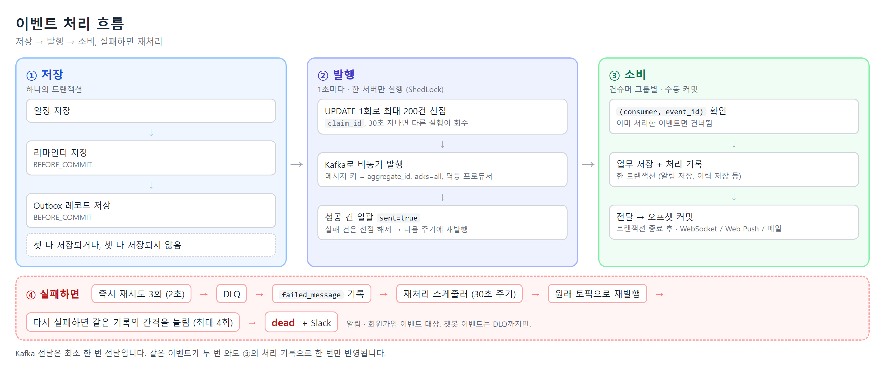
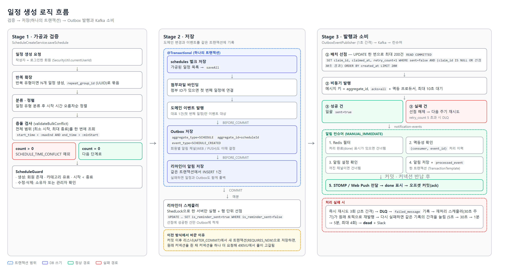
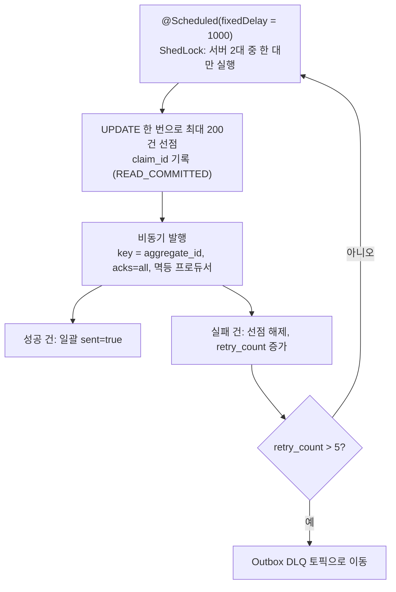
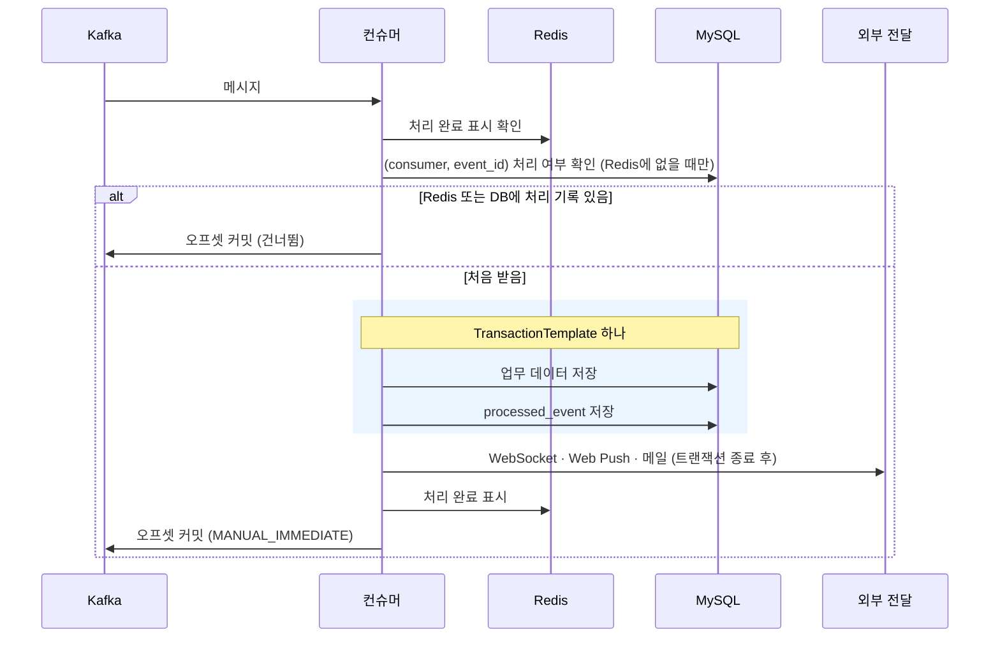
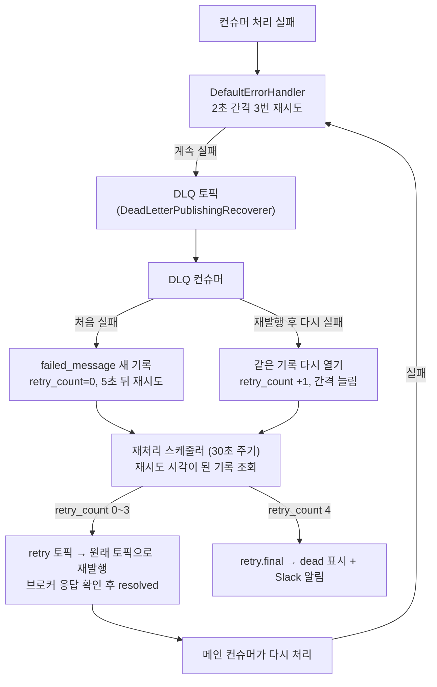

# 이벤트 흐름

일정 변경·회원가입·챗봇 응답 같은 도메인 변경은 Outbox에 이벤트로 함께 저장되고, 발행기가 Kafka로 보내면 토픽별 컨슈머가 후속 처리(알림, 이메일, 챗봇 이력)를 맡습니다.
이 문서는 저장 → 발행 → 소비 → 실패 처리 순서로 실제 코드 동작을 정리합니다. 왜 이렇게 설계했는지는 [설계 과정 의사결정](../architecture/design-decisions.md)을 참고하세요.

## 한눈에 보기

## 1. 저장

도메인 데이터, Outbox 행, 리마인더 알림을 **한 트랜잭션**으로 커밋합니다. 셋 중 하나라도 실패하면 모두 롤백됩니다.

일정 생성을 예로 들면, 검증부터 저장·발행·소비까지 이렇게 이어집니다.

- Outbox와 리마인더는 `@TransactionalEventListener(phase = BEFORE_COMMIT)`에서 저장합니다 (`ScheduleEventListener`).
- 리마인더 저장 방식은 두 번 바뀌었습니다.

| 시기 | 방식 | 문제 |
|---|---|---|
| ~09-11 | `AFTER_COMMIT` + 기본 전파(REQUIRED) | 이미 끝난 트랜잭션에 참여해 예외 없이 저장되지 않음 |
| 10-01 (#74) | `AFTER_COMMIT` + `REQUIRES_NEW` | AFTER_COMMIT 리스너가 끝날 때까지 원래 커넥션을 반납하지 않아 요청당 커넥션 2개 → 490VU에서 풀 고갈 |
| 10-03 (#79) | `BEFORE_COMMIT`, 같은 트랜잭션 | 지금 방식. 리마인더 저장이 실패하면 일정 저장도 함께 롤백됨 |

원칙: 부수 작업은 "같은 트랜잭션" 아니면 "Outbox를 통한 비동기" 둘 중 하나로만 처리하고, 커밋 이후 리스너에서 DB에 쓰지 않습니다.

## 2. 발행

- **선점:** 선점되지 않았거나 선점 후 30초가 지난 행만 가져옵니다. 발행 도중 서버가 죽어도 30초 뒤 다른 실행이 회수합니다.
- **격리 수준:** 선점 트랜잭션만 `READ_COMMITTED`입니다. REPEATABLE READ에서는 `UPDATE … ORDER BY created_at LIMIT 200`이 미발행 구간 끝의 간격까지 잠가 새 Outbox INSERT를 막았습니다 (#80).
- **중복:** ShedLock과 선점이 겹치는 순간에 생길 수 있는 중복 전달은 컨슈머 멱등 처리가 막습니다.
- **이전 방식:** 건마다 UPDATE를 두 번 실행해 한 주기에 DB 왕복이 약 400번 → 초당 약 60~70건이 상한이었습니다 (#77에서 배치 선점으로 변경).

## 3. 소비

| 토픽 | 컨슈머 | 하는 일 |
|---|---|---|
| `notification-events` | 알림 컨슈머 | 알림 저장 → WebSocket(STOMP) / Web Push 전달 |
| `member-signup-events` | 가입 컨슈머 | 환영 이메일 |
| `chat-history` | 이력 저장 컨슈머, 패턴 분석 컨슈머 (서로 다른 그룹) | MySQL 이력 + Redis 대화 맥락, 사용 패턴 분석 |

- **멱등성 키:** `(consumer, event_id)`. 하나의 이벤트를 여러 컨슈머 그룹이 각자 처리하므로 키에 컨슈머를 넣었습니다. `event_id`만 쓰던 때는 먼저 처리한 그룹이 다른 그룹을 막았습니다 (#74).
- **Redis 표시 시점:** 처리가 끝난 뒤에만 기록합니다. 처리 시작 시점에 찍으면 "처리 중"과 "완료"를 구분하지 못해, 처리 도중 실패한 메시지의 재시도를 버렸습니다 (#81).
- **예외:** 저장 중 예외는 삼키지 않고 전파해 아래 재시도 경로를 탑니다 (#81).
- **외부 전달은 트랜잭션 밖:** 커넥션을 반납한 뒤에 전달합니다. 커밋 이후 콜백(`afterCommit`)은 커넥션이 묶인 채라 쓰지 않았습니다.
- **Poison Pill:** `ErrorHandlingDeserializer`가 역직렬화할 수 없는 메시지로 컨슈머가 멈추지 않게 합니다.

## 4. 실패와 재처리 (알림·회원가입)

| 재발행 차수 | `retry_count` | 재발행 전 대기 | 토픽 |
|---|---|---|---|
| 1 | 0 | 5초 | `*.retry.5s` |
| 2 | 1 | 30초 | `*.retry.10s` |
| 3 | 2 | 1분 | `*.retry.30s` |
| 4 | 3 | 5분 | `*.retry.60s` |
| 포기 | 4 | 10분 | `*.retry.final` → dead + Slack |

- 대기 시간은 `FailMessageModel`의 다음 재시도 시각과 30초 주기 스케줄러가 만듭니다. 그래서 실제 대기는 표의 값보다 최대 30초 늦을 수 있습니다.
- retry 토픽은 받자마자 원래 토픽으로 넘기므로, 토픽 이름의 시간(5s~60s)만큼 기다리지는 않습니다 (한계 참고).
- 알림 스케줄러는 `NOTIFICATION`·`WEB_PUSH`, 회원가입 스케줄러는 `MEMBER_SIGNUP` 기록만 가져갑니다.
- **챗봇 이벤트는 DLQ까지만** 보냅니다. DLQ를 받는 컨슈머가 아직 없습니다.

이 경로는 단위 테스트가 아니라 Kafka·MySQL 컨테이너 통합 테스트로 확인했습니다 (재시도 3회 → DLQ → 재발행 → 재실패 시 같은 기록 재개 → 최종 dead). 이 테스트를 작성하면서 DLQ 재처리가 한 번도 동작하지 않았던 문제(매퍼 필드 누락, 재시도 시각 누락, 재실패 유실, 전송 응답 미확인, 컬럼 누락)를 찾아 고쳤습니다 (#84).

## 5. 주요 값과 코드 위치

| 항목 | 값 | 위치 |
|---|---|---|
| 발행 주기 / 배치 크기 / 선점 만료 | 1초 / 200건 / 30초 | `common/events/.../OutboxEventPublisher.java` |
| 선점 격리 수준 | `READ_COMMITTED` | `common/events/.../OutboxEventService.java` |
| Outbox → DLQ | `retry_count > 5` | `common/events/.../OutboxDlqProcessor.java` |
| 컨슈머 재시도 | `FixedBackOff(2000, 3)`, `MANUAL_IMMEDIATE` | `KafkaConsumerConfig.java` |
| 재처리 스케줄러 | 30초 주기, ShedLock | `NotificationDlqRetryScheduler.java`, `MemberSignUpDlqRetryScheduler.java` |
| 재시도 간격 | 5초 → 30초 → 1분 → 5분 → 10분 | `DlqNotificationRetryConsumer.java`(첫 5초), `FailMessageModel.java` |
| Outbox·리마인더 저장 | `BEFORE_COMMIT` | `ScheduleEventListener.java` |

## 6. 남은 한계

- 챗봇 DLQ(`chat-history.DLQ`, `chat-events.DLQ`)를 받는 컨슈머가 없어 재처리되지 않습니다.
- DLQ 컨슈머가 `failed_message` 저장에 실패하면 예외를 삼켜, DB 장애 중 들어온 DLQ 메시지가 사라질 수 있습니다.
- retry 토픽 이름과 실제 지연이 다릅니다. 토픽을 하나로 줄이거나 지연 재시도 토픽(`@RetryableTopic`)을 검토할 예정입니다.
- 발행 실패나 DLQ를 거친 메시지는 뒤 메시지보다 늦게 처리될 수 있습니다. 지금 컨슈머는 기록을 쌓는 처리라 문제가 없지만, 상태를 덮어쓰는 컨슈머가 생기면 이벤트 버전으로 오래된 이벤트를 걸러야 합니다.
